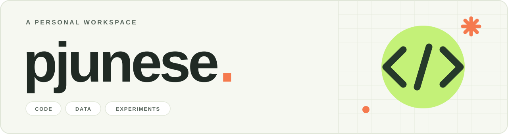

<picture>
  <source media="(prefers-color-scheme: dark)" srcset="./assets/profile-header-dark.svg">
  <source media="(prefers-color-scheme: light)" srcset="./assets/profile-header-light.svg">
  
</picture>

### 배우고, 만들고, 다시 개선합니다.

안녕하세요, **pjunese**입니다. AI 모델을 실험하고, 데이터를 다루고, 서비스를 만들어봅니다.

  
  
  

 

## Selected projects

### [Verimarka · AI Module ↗](https://github.com/pjunese/2026-project)

이미지 유사도 검색, 워터마크 삽입·검출, 문서 OCR을 연결한 AI 처리 모듈입니다.

`Python` · `SigLIP2` · `pgvector`

---

### [PayScope ↗](https://github.com/pjunese/PayScope)

영수증 OCR과 지출 관리를 React 화면과 Django API로 연결한 서비스입니다.

`React` · `Django` · `MongoDB`

---

### [Tiny-ImageNet-CF ↗](https://github.com/pjunese/Tiny-ImageNet-CF)

100만 개 미만의 파라미터로 Tiny-ImageNet 이미지 분류 모델을 학습하고 최적화한 프로젝트입니다.

`Python` · `PyTorch` · `torchvision`

 

## Problem solving

